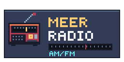
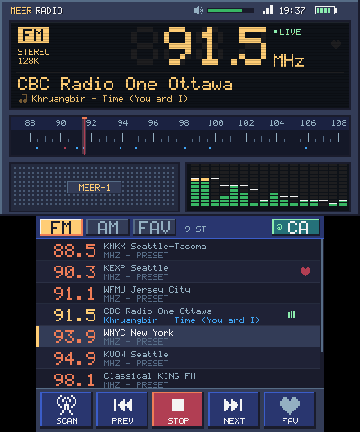
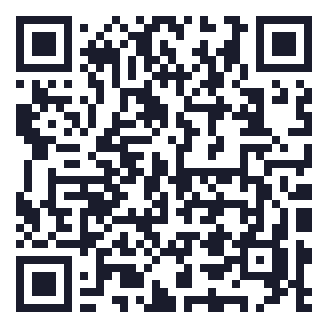

<div align="center">



# Meer Radio

**AM/FM radio for the Nintendo 3DS**

Pixel-art tuner · real station frequencies · song titles · spectrum visualizer

[](https://github.com/meerok/MeerRadio3ds/actions/workflows/build.yml)
[](https://github.com/meerok/MeerRadio3ds/releases/latest)



</div>

---

## Install

### QR code (fastest)

On your 3DS open **FBI > Remote Install > Scan QR Code** and point the camera at this:



### Manual

1. Download `MeerRadio.cia` from the [latest release](https://github.com/meerok/MeerRadio3ds/releases/latest).
2. Copy it to your SD card.
3. Open FBI, find the file and choose **Install CIA**.

Meer Radio then shows up on your HOME Menu.

> **Before you start:** you need custom firmware (Luma3DS) and a DSP dump. Run **DSP1** once so `sdmc:/3ds/dspfirm.cdc` exists, otherwise homebrew has no sound.

---

## How it works

The 3DS has no AM/FM radio chip, so Meer Radio plays real AM and FM stations from their internet streams over Wi-Fi. Every station sits at its real frequency on the dial.

## Features

| | |
|---|---|
| 📻 **FM, AM and Favorites** | A frequency dial with a sliding needle and a marker for every station |
| 📡 **SCAN** | Loads hundreds of real AM/FM stations for your country from radio-browser.info |
| 🎵 **Now playing** | Song titles from the station scroll across the LCD |
| 📊 **Visualizer** | 16-band spectrum meter with peak caps and a speaker grille that pulses with the bass |
| 🌫️ **Tuning static** | Soft static while a station locks on, like a real radio |
| 🌙 **Lid closed** | Keeps playing with the lid shut and switches the screens off |
| 💾 **Remembers** | Volume, favorites, country and your last station |

## Controls

| Button | Action |
|---|---|
| D-Pad ◀ ▶ | Previous / next station |
| D-Pad ▲ ▼ | Move through the list |
| A | Play the selected station (press again to stop) |
| B | Stop |
| X | Favorite on/off |
| Y | Switch band: FM, AM, FAV |
| L / R | Volume down / up |
| SELECT | Screens off (any button turns them back on) |
| START | Exit |
| Touch | Tap stations, tabs and buttons. Drag the list to scroll |

## Picking your country

The first launch scans Canadian stations. To change that, tap the **@CA** button at the top of the touch screen until your country shows (US, GB, AU, NZ, IE, DE, FR and more), then tap **SCAN**.

## Adding your own stations

Edit `sdmc:/3ds/MeerRadio/stations.txt`. One station per line:

```
FM|90.3|KEXP Seattle|https://kexp-mp3-128.streamguys1.com/kexp128.mp3
AM|580|My Station|http://example.com/stream.mp3
```

Streams need to be **MP3** (plain HTTP/HTTPS, Shoutcast/Icecast, or a .pls/.m3u that points to one). AAC and HLS (.m3u8) streams aren't supported yet, so some big commercial stations won't appear after a scan.

### Files on your SD card

| File | What it is |
|---|---|
| `/3ds/MeerRadio/stations.txt` | Your station list, edit freely |
| `/3ds/MeerRadio/scanned.txt` | Stations from the last SCAN, replaced on every scan |
| `/3ds/MeerRadio/settings.txt` | Volume, country, favorites and last station. Set `static=0` to turn off tuning static |

---

## Building from source

Every push to `main` is built by GitHub Actions, which publishes `MeerRadio.cia` and `MeerRadio.3dsx` to the latest release.

To build on your own computer:

1. Install [devkitPro](https://devkitpro.org/wiki/Getting_Started) with the 3DS tools.
2. Install the libraries:
   ```
   sudo dkp-pacman -S 3ds-dev 3ds-curl 3ds-mbedtls 3ds-zlib 3ds-mpg123
   ```
3. Put [makerom](https://github.com/3DSGuy/Project_CTR/releases) and [bannertool](https://github.com/Steveice10/bannertool/releases) on your PATH.
4. Run `make cia`.

Built with libctru, citro2d, libcurl, mbedTLS and libmpg123.

## Credits

- Station directory: [radio-browser.info](https://www.radio-browser.info)
- Colors: Sweetie 16 palette by GrafxKid
- Made by **Meer**
